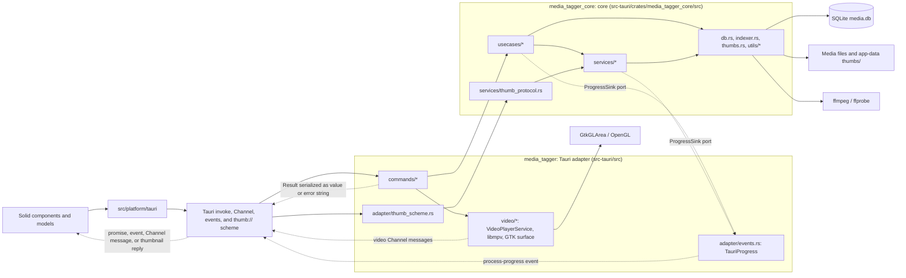
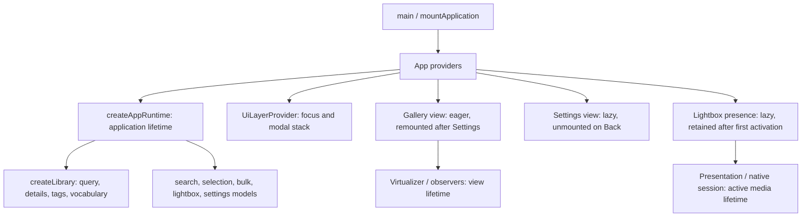

# System overview

Implementation entry points: [Tauri bootstrap](../../src-tauri/src/lib.rs), [core startup phases](../../src-tauri/crates/media_tagger_core/src/app/bootstrap.rs), [workflow locks](../../src-tauri/crates/media_tagger_core/src/app/locks.rs), [application state](../../src-tauri/crates/media_tagger_core/src/app/state.rs), [GPUI bootstrap](../../src-gpui/crates/media_tagger_gpui/src/lib.rs).

This page describes the architecture that is implemented today. The source code and executable configuration are authoritative.

For narrower contracts, use the canonical pages for [frontend architecture](../frontend/architecture-and-ui-conventions.md), [IPC](ipc-contract.md), [database persistence](../subsystems/database.md), [scanning](../subsystems/scanning-and-indexing.md), [library queries and the gallery](../subsystems/library-query-and-gallery.md), [thumbnails](../subsystems/thumbnails.md), [search, tags, and media groups](../subsystems/search-tags-and-media-groups.md), [lightbox behavior](../subsystems/lightbox.md), [settings operations](../subsystems/settings-operations.md), and [data safety and portability](../subsystems/data-safety-and-portability.md).

## Architecture and data flow

Solid arrows cross the package boundary only from the adapter into the core. The core reaches the runtime only through ports that the adapter implements (`ProgressSink` by `TauriProgress`; `ThumbHost` and `ThumbResponder` by the `thumb://` handler), and it compiles without any Tauri, GTK, WebKit or libmpv crate ([ADR 0034](../adr/0034-tauri-independent-backend-core.md)).

Solid 2 is the only frontend.
The normal request path is:

1. `src/app/main.tsx` calls `mountApplication`, which applies the persisted theme, loads i18next and mounts the application. Optional frontend performance instrumentation is enabled by `VITE_MEDIATAGGER_PERF=1`.
2. `src/app/App.tsx` composes language, runtime and UI-layer owners. `createAppRuntime` owns library, search, selection, bulk, lightbox and settings models across view changes. Settings and lightbox are lazy-loaded and prefetched after 1.5 seconds; the gallery is eagerly imported.
3. Feature and library models call typed functions in `src/platform/tauri`. Its subsystem modules construct command payloads, video channels, `thumb://` thumbnail URLs and image/GIF URLs.
4. Tauri dispatches the request to a function registered by `tauri::generate_handler!` in `src-tauri/src/lib.rs`. Command functions are thin: they take the arguments, obtain `AppState` (or its `database`), run the matching use case in `usecases/` on the blocking pool and convert the result to the wire (an error string, or raw bytes as `tauri::ipc::Response`). The use case validates or normalizes inputs, acquires a workflow lock where required, and either performs a small operation or delegates to a service.
5. Services coordinate scanning, query sessions, backups, progress, and thumbnail scheduling. `db.rs` owns SQL; `indexer.rs` discovers and inspects media; `thumbs.rs` performs image/video probing and rendering; filesystem mutations occur in the use case or service responsible for that workflow.
6. Results return through the invoke promise. Long-running settings work also emits `process-progress`; native video sessions use channels. On-demand thumbnails are not IPC: tiles load the `thumb://` scheme.

Concrete examples:

- Gallery refresh calls `startAssetQuery`, which invokes `start_asset_query`. The query manager reads the library revision through a small connection pool, caches at most four ID-list sessions for five minutes after their last lookup (a held range selection keeps its session alive, [ADR 0029](../adr/0029-range-selection-keeps-its-session-alive.md)), and materializes requested summaries from SQLite. Later pages call `get_asset_query_page`; a revision mismatch returns `stale`, causing the frontend to refresh.
- A scan invokes `scan_folder` or `rescan_all_roots`, takes the scan lock, walks supported files, fingerprints them, extracts metadata (including video duration through ffprobe/ffmpeg), commits batched SQLite updates, and removes stale database rows. Scanning reads source media; it does not copy it into app data.
- Gallery tiles load `thumb://` URLs by asset ID and version token. The scheme handler takes the shared thumbnail lock for short read and publication sections and submits deduplicated Interactive (LIFO) jobs to the process-wide scheduler. Images are decoded in Rust; video frames use ffmpeg. Successful paths and failures are persisted in SQLite, and the generated files live under the profile's `thumbs/` directory.
- Delete, rename, root removal, library clear, and bundle restore cross both SQLite and the filesystem. These operations take both workflow locks, always in the order described below.
- Original image and GIF paths use Tauri's asset protocol. Thumbnails use the app's own `thumb://` scheme, addressed by asset ID and version token. Video opens by asset ID after backend path authorization. libmpv renders into a GTK `GLArea` above the WebView, with native controls above the video. DOM controls must stay outside those native bounds. See [lightbox media presentation](../subsystems/lightbox.md#media-presentation) for authorization, layout, and session behavior.

## Frontend owner lifetimes

Model state survives gallery/settings switching; DOM measurements, scroll elements and
view-local drafts do not. Bulk dock code is eager with the gallery. Settings/lightbox
views prefetch after 1,500 ms, while their models already exist. Logical lightbox close
releases modality and native playback before retained content finishes its exit. Bootstrap
and each owner dispose their own registrations and reject late async publication. See
[frontend architecture](../frontend/architecture-and-ui-conventions.md) for the ownership
contracts and [testing](../development/testing.md) for their observed coverage.

## Executable bootstrap and runtime lifecycle

`src-tauri/src/main.rs` is deliberately only the binary entry point and calls `media_tagger::run()`. The actual Tauri bootstrap is the library function `run()` in `src-tauri/src/lib.rs`. It only composes the application; the framework-free startup phases live in `app::bootstrap` of the core crate `media_tagger_core` (`open_storage`, `resolve_ffmpeg_path`, `start_workers`), which manages no state and is tested on a temporary profile without Tauri. `run()`:

1. creates a `tauri::Builder`, installs the dialog and opener plugins, and registers the `thumb://` scheme (`adapter/thumb_scheme.rs`; until `AppState` is managed at the end of setup, `try_state` finds no state and the core handler answers `503`);
2. during `setup`, refuses a debug build unless its effective identifier is the established development or E2E identifier;
3. resolves and creates the identifier-specific app-data directory;
4. acquires and manages the profile's `InstanceLock` before opening the database;
5. calls `bootstrap::open_storage`, which recovers any interrupted journaled database/thumbnail restore and then removes abandoned backup/restore temporaries from the profile directory (best effort) before creating `thumbs/` or opening `media.db`, then initializes or migrates the schema on a FULL-sync startup connection, reconciles pending source-file operations, and captures the scan-root settings before automatic scanning; `setup` manages them as `StartupScanState`;
6. resolves the resource directory and ffmpeg (`bootstrap::resolve_ffmpeg_path`), restores `LC_NUMERIC` to `C` after GTK initialization for libmpv, creates the process-wide `VideoPlayerService`, and installs the GTK video surface;
7. calls `bootstrap::start_workers`, which creates the thumbnail scheduler, refuses startup if any worker failed to spawn, and builds `AppState`; managing that `AppState` is the last step of `setup`, and the startup connection closes when `setup` returns;
8. registers every frontend-callable command; and
9. runs the generated Tauri context until the application exits.

Startup failure in any setup step prevents the windowed application from entering its normal event loop. `build.rs` only calls `tauri_build::build()`; compile-time application metadata and resources come from the effective Tauri configuration.

## Backend module boundaries

`src-tauri/` is a Cargo workspace with two packages ([ADR 0034](../adr/0034-tauri-independent-backend-core.md)):

- **`media_tagger`** (`src-tauri/Cargo.toml`, sources in `src-tauri/src/`): the Tauri adapter. It owns the binary, `build.rs`, the `custom-protocol` feature and every Tauri, GTK, WebKit and libmpv dependency.
- **`media_tagger_core`** (`src-tauri/crates/media_tagger_core/`, sources in its `src/`): the backend core. It depends on no GUI crate, and the adapter imports it by path as `media_tagger_core::…`, without re-exports.

Both are workspace `members` and `default-members`, so `cargo build`, `cargo test` and `cargo clippy` on `src-tauri/Cargo.toml` cover both. Shared dependency versions (`anyhow`, `image`, `libc`, `rusqlite`, `serde`, `serde_json`, `tempfile`) live in `[workspace.dependencies]`. Module paths below are relative to the owning package's `src/`.

| Module | Package | Current responsibility |
| --- | --- | --- |
| `main.rs` | adapter | Native binary shim only. |
| `lib.rs` | adapter | Composition only: builder, plugins, `thumb://` registration, profile safety guard, Tauri paths (`app_data_dir`, `resource_dir`), `InstanceLock`, the video phase, `manage()` of every state, command registration, and process launch. |
| `app/bootstrap.rs` | core | Framework-free startup phases called by `lib.rs`: `open_storage` (restore recovery, sweep of backup temporaries, `thumbs/`, `media.db` and schema, pending file-operation recovery, scan-root snapshot), `resolve_ffmpeg_path` (bundled, executable-adjacent and system ffmpeg precedence), and `start_workers` (thumbnail scheduler and `AppState`). It returns values and never manages state. |
| `app/state.rs` | core | Process-wide shared runtime state: `AppState`. |
| `app/instance_lock.rs` | core | Per-profile interprocess ownership of the app-data directory. |
| `app/locks.rs` | core | In-process workflow lock helpers and the canonical combined lock order. |
| `app/profile.rs` | adapter | Debug/test-only allowlist of the development and E2E identifiers used by the profile guard. |
| `commands/*` | adapter | Thin Tauri IPC endpoints: arguments → `spawn_blocking` → use case → error-string conversion (or `tauri::ipc::Response` for the binary ID range). They take no workflow lock, open no connection and run no SQL. `commands/video.rs` also drives the native player in the adapter (ADR 0034, D1); its source lookup is the core use case `usecases::video`. |
| `usecases/*` | core | The workflows behind the commands, one file per command file (`assets`, `scan`, `thumbs`, `import_export`, `video`), without Tauri: input validation and normalization (query filters and owner IDs, the 256-ID summary batch limit, media-group keys), the workflow locks of `app/locks.rs`, SQL through `db`, progress through the `ProgressSink` port, and delegation to services. Each `commands/X.rs::foo` runs `usecases::X::foo_service`; `usecases::video::open_video_service` resolves and authorizes the source of `open_video` through `video_source_service`, and the player itself stays in the adapter. `start_asset_query` is split in two: `begin_asset_query_service` validates and takes the per-owner request token before the blocking task, `start_asset_query_service` runs in it. |
| `adapter/*` | adapter | Tauri implementations of core ports and Tauri-only runtime state: `events.rs` holds `TauriProgress`, a newtype over `&AppHandle` that implements `ProgressSink` and emits `process-progress` (the orphan rule forbids implementing the core trait for the Tauri type itself, so the commands pass `&TauriProgress(&app)` to the use cases); `startup_scan.rs` holds `StartupScanState` (launch snapshot, waiters on `tauri::async_runtime` channels, retained result) and `run_startup_scan`, which runs the process-owned startup scan task; `thumb_scheme.rs` is the `thumb://` handler registered on the builder: it answers a non-GET or malformed request on the GTK main thread, runs the core `serve` on the blocking pool, provides `AppState` through `try_state` (the `ThumbHost` port), and turns each `ThumbReply` into an HTTP response. |
| `services/*` | core | Asset-query sessions, safe/journaled asset file mutation, SQLite connection pooling, asset-ID video source authorization (`video_source_service.rs`: the canonical path of a regular file, the only video code in the core), scan orchestration, thumbnail workflows, backup/restore, CSV, the `ProgressSink` progress port (`progress.rs`), and the framework-free `thumb://` core (`thumb_protocol.rs`: URL parser, allowed origins, replies as `ThumbReply` data with status, CORS and cache headers, and the publisher that commits finished renders in batches; it reaches the runtime only through the `ThumbHost` and `ThumbResponder` ports). |
| `video/*` | adapter | Native video, entirely in the adapter (ADR 0034, D1): `player.rs` holds `VideoPlayerService` (the process-wide libmpv handle, the playback worker, `PLAYER_OPTIONS` and `SCRIPT_OPTIONS`) and the `open_video` channel messages `VideoEvent`, `VideoEventPayload` and `PlaybackSnapshot`; `mpv_events.rs` wraps the libmpv client event API; `surface.rs` does GTK overlay/GLArea placement, native controls and libmpv OpenGL rendering; `types.rs` holds the command inputs `VideoBounds` and `VideoControlLabels` with their validation. |
| `db.rs` and `db/*` | core | Shared types plus separate connection, schema, query, mutation, scan-membership, thumbnail, and query-revision SQL modules. Connections use WAL, `synchronous=NORMAL`, foreign keys, a memory temp store, cache/mmap tuning, and a five-second busy timeout. |
| `indexer.rs` | core | Supported-file discovery, fingerprints, and media metadata extraction. |
| `thumbs.rs` | core | Image/video thumbnail creation and video duration probing. |
| `models.rs` | core | Backend serializable data models. |
| `utils/*` | core | Path, tag, and text normalization helpers. |
| `test_support.rs` | core | Test-only fixtures for ADR 0028: reference files named `*.mp4`, a loopback listener and an inotify open watch, shared by the ffmpeg/ffprobe tests in `thumbs.rs` and the player tests in the adapter's `video/player.rs`. Compiled under `#[cfg(any(test, feature = "test-support"))]`; only the adapter's `[dev-dependencies]` enable `test-support`, so it never reaches a release build. |
| `error.rs` | core | `AppError` and `AppResult`; command boundaries currently flatten errors to strings. |

The core/adapter boundary ([ADR 0034](../adr/0034-tauri-independent-backend-core.md), plan [hexagonal-backend](../plans/hexagonal-backend/README.md)) is enforced as follows:

- **By the compiler.** `media_tagger_core` has no Tauri, GTK, WebKit or libmpv dependency, so naming one in the core does not compile. The core cannot see the adapter either: `crate::commands`, `crate::adapter`, `crate::video` and `media_tagger::…` do not resolve there. `cargo tree -p media_tagger_core --locked -e normal` lists no GUI crate.
- **By the core manifest test.** `core_manifest_has_no_gui_dependencies` in `src-tauri/tests/architecture_boundaries.rs` rejects a GUI crate (`tauri`, `tauri-*`, `gtk`, `gdk`, `glib`, `webkit2gtk`, `libmpv2`, `libmpv2-sys`, `async-channel`, `libloading`, `wry`, `tao`) in any dependency table of `crates/media_tagger_core/Cargo.toml`, including renamed and target-specific dependencies.
- **By the source scanner** in the same file, for what the compiler cannot see inside one package:
  - `db.rs` and `db/*` of the core reference no `services`, `app` or `usecases`.
  - The core's `app/bootstrap.rs` references no `usecases`: startup prepares storage and `AppState`, and use cases run only on a managed `AppState`.
  - Inside the adapter, `video/` does not reference `commands`: the commands import `video::{player, surface, types}`, never the reverse.
  - The adapter's `commands/` contains no `db::` path, no `Connection`, no `admit`, no `with_*lock` helper and no `locks` path: connections, SQL and the workflow locks are reached only through the core's `usecases/` (rule 4).
  - In the adapter's `lib.rs`, `app.manage(bootstrap::start_workers(..)?)` is the last step of `setup`, followed only by `Ok(())` (`app_state_is_managed_last_in_setup`), so `thumb://` keeps answering `503` until every other phase has run.
- **By use-case tests** for the validation error texts that cross the wire: the query owner ID, the 256-ID summary batch, the `hasNoTags` filter, a missing scan folder and the busy-library key are compared as literals.

### Managed state

`AppState` contains:

- the profile-specific `db_path` and `thumbs_dir`;
- the resolved `ffmpeg_path` (also copied into the scheduler);
- `scan_lock` and `thumb_lock`;
- the shared `ThumbnailScheduler`; and
- atomics that enforce one bulk-thumbnail render, carry its cancellation request, guard thumbnail publication with a generation epoch, and preserve cancellation without database or workflow locks.

`StartupScanState` (`adapter/startup_scan.rs`) is separately managed by Tauri. It is built from the scan-root settings (`db::list_scan_root_settings`) that `app::bootstrap::open_storage` captures after database initialization and recovery; only enabled roots are scanned. The first startup-scan invocation consumes that snapshot and starts one process-owned task. Concurrent invocations await the same task; later invocations replay its retained summary or error. A launch with no enabled roots returns null. Dropping a frontend observer does not cancel the task or lose its result. Preference changes apply to the next process. Startup scanning uses the normal blocking pool, scan lock, and progress pipeline: the adapter owns the waiting and the async task, and the scan itself is the core `scan_service::scan_roots` under `with_scan_lock`.

The `InstanceLock` and `VideoPlayerService` are separately managed by Tauri so their lifetimes match the application. The player service owns one process-wide libmpv handle, one active session, a dedicated playback worker, and monotonically increasing request/session IDs. The worker owns libmpv commands and per-session event clients; GTK only enqueues playback commands, and its render handler never waits for libmpv's frame timing ([ADR 0012](../adr/0012-non-blocking-native-video-render.md)). `video/mpv_events.rs` checks native client creation and copies event information before the next poll invalidates it. Pending reservations can be cancelled before source resolution completes. It rejects stale controls and superseded opens, while retired-session closes are idempotent. `AppState.database` owns admission, the connection pool, and query state. One operation permit follows its connections and child workers. Idle connections retain no admission.

## GPUI port: a second adapter in its own workspace

A second interface is being built on the same core ([ADR 0036](../adr/0036-gpui-second-adapter-in-its-own-workspace.md), plan in [docs/plans/gpui-port](../plans/gpui-port/README.md)). The Tauri application above is unchanged and stays the behaviour reference; what exists of the port today is the application shell (runtime, window with its own decorations, the two views with their headers), and each epic of the plan adds to it.

`src-gpui/` is a separate Cargo workspace with its own `Cargo.lock` and its own target directories (`src-gpui/target`, `src-gpui/target-e2e`). Its commands take `--manifest-path src-gpui/Cargo.toml`. `src-tauri/Cargo.toml` and `src-tauri/Cargo.lock` do not know it exists.

| Package | Location | Responsibility |
| --- | --- | --- |
| `media_tagger_client` | `src-gpui/crates/media_tagger_client` | Presentation logic without a GUI: the `Backend` port with its core adapter (`backend.rs`, `backend/core_backend.rs`), the model convention and the executors (`model.rs`, `exec/`), the progress stream, the single-flight startup scan and the thumbnail pipeline (`progress.rs`, `startup_scan.rs`, `thumbs.rs`), the library's query model with its bounded page cache and the query-impact rule (`library.rs`, `library/`; [library query and gallery](../subsystems/library-query-and-gallery.md#gpui-port-the-query-model)), texts from `src/i18n/locales` with plurals, interpolation and backend text (`i18n.rs`, `i18n/`), the theme tokens of `src/styles.css` as constants checked against the stylesheet (`theme.rs`, `theme/`), the stored theme and language behind the `PrefsStore` port with a file adapter in the profile directory (`prefs.rs`, `prefs/`), the editing model of the single-line text field (`text.rs`, `text/`: buffer, selection, input-method composition, undo, key table; [frontend conventions](../frontend/architecture-and-ui-conventions.md#gpui-port-the-text-field)), the looks and keys of the shared controls (`controls.rs`, `controls/`), the icon catalogue (`icons.rs`), the layer stack and modal presence of the overlay layer (`overlay.rs`, `overlay/`; [ADR 0039](../adr/0039-gpui-overlay-layers-and-controls.md)), the named start states of the comparison harness (`scenario.rs`), the application runtime that lives as long as the application (`runtime.rs`, `runtime/`: view, theme, language, tile size, the embedded query model, the start sequence with the single startup scan; [frontend conventions](../frontend/architecture-and-ui-conventions.md#gpui-port-runtime-window-and-shell)), what the shell draws and the window's own decorations (`shell.rs`, `window_chrome.rs`), the registry of key contexts and shortcuts (`shortcuts.rs`), and the model of the `kit` board (`kit.rs`). The locale files are embedded with `include_str!` and the token constants fail their tests when they differ from the stylesheet, so the two interfaces cannot drift apart in copy or colour. |
| `media_tagger_gpui` | `src-gpui/crates/media_tagger_gpui` | The GPUI adapter and the binary `media_tagger_gpui`: `cli.rs` (arguments), `profile.rs` (identifier allowlist, app-data directory), `scenario.rs` (start states, E2E profile only), `boot.rs` (startup composition), `window.rs` (main window with client-side decorations and event loop), `runtime.rs` (the runtime entity: the client's `AppRuntime` driven on the executor and pumped on the UI thread through a wake signal), `ui/` (building blocks GPUI does not ship: `ui/text_input.rs` is the text field, [ADR 0038](../adr/0038-gpui-text-field-own-element-and-key-context.md); the theme global, the bundled fonts, the icon assets of `assets/icons/`, the shared controls, the layer stack and the modal, [ADR 0039](../adr/0039-gpui-overlay-layers-and-controls.md); `ui::init` sets up the theme and layer globals and registers their key bindings at startup, after `window::init_application` has registered the fonts), `views/` (the shell, the gallery and settings views with their headers, the window buttons and resize grips in `views/chrome.rs`, and the `kit` board). |

Dependency direction: `media_tagger_gpui` → `media_tagger_client` → `media_tagger_core`. The core is the path dependency `../src-tauri/crates/media_tagger_core` and stays a member of the Tauri workspace, which is where its `*.workspace = true` keys resolve. GPUI itself (`gpui`, `gpui_platform`) comes only from the `zed-industries/zed` repository, pinned in `src-gpui/Cargo.toml` to the commit of a stable release tag.

Startup of the GPUI binary (`media_tagger_gpui::run`): identifier guard → scenario guard → display check → app-data directory → `boot::start`, which runs the core phases in the Tauri order without the Tauri-only ones: `create_dir_all` → `InstanceLock::acquire` → `bootstrap::open_storage` → `bootstrap::resolve_ffmpeg_path` (resource directory: the executable's directory) → `bootstrap::start_workers`. The returned `Boot` owns `AppState` (shared, `Arc`), the startup scan-root snapshot and the instance lock. Then the preferences are read from the profile (`FilePrefsStore`; a scenario uses its own theme and English instead), `CoreBackend` is attached to the state and the snapshot, and a `ThreadExecutor` is made for backend calls; the main window's runtime starts once the window is open (library refresh, the startup scan, the scan-root list). Closing the last window ends the event loop (`QuitMode::LastWindowClosed`); the executor is shut down (queued calls are dropped, a running one ends with the process) and `Boot` is dropped, which releases the instance lock, and the process exits with status 0. The backend and its thumbnail publisher still hold `AppState` then, so its database pool closes with the process. A main window that cannot open (no usable GPU adapter, for example) ends the event loop too: the quit is requested from a task inside the loop, because GPUI's Linux loop forgets a quit requested from the launch callback, and `run` returns `cannot open the main window: …` after `Boot` has been dropped (exit status 1). Dropping `Boot` does not stop the thumbnail workers: the core's scheduler has no shutdown, so its threads end with the process. `media_tagger_gpui --identifier` prints the baked identifier and exits without touching a display or the disk. `media_tagger_gpui --scenario <id>` starts in a named state of `media_tagger_client::scenario` for the [comparison harness](../development/testing.md#comparison-harness-tauri-and-gpui); the scenario guard (`scenario::start_state`) accepts it only on the E2E profile and refuses an unknown id, before the display check. `--scenario kit` starts the E2E build on the board of every shared control in both themes; it is not a comparison scenario and has no Tauri counterpart. Any other argument is refused (`cli::parse`).

The display check (`window::require_display`) runs before the profile is opened because GPUI only looks at whether the variables are set: with neither `WAYLAND_DISPLAY` nor `DISPLAY` it would start headless and never show a window to close, and with `WAYLAND_DISPLAY` set it never tries X11 and panics when no compositor answers. The check probes each named server with one socket connection, in GPUI's order (Wayland, then X11), and starts GPUI on the first that answers, so a stale `WAYLAND_DISPLAY` next to a live `DISPLAY` opens the window on X11. No variable, or no answer, is a startup error with exit status 1 and no app data touched. A server it cannot probe counts as answering: a compositor inherited through `WAYLAND_SOCKET`, and a `DISPLAY` that is not a local `:N`.

Boundaries that the compiler cannot see are checked by `src-tauri/tests/architecture_boundaries.rs`, which scans `../src-gpui/crates`:

- the manifest of `media_tagger_client` names no GUI crate (the `GUI_CRATES` list plus `gpui*`, `wgpu*`, `blade*` and `media_tagger_gpui`);
- outside `backend/core_backend.rs` (`CoreBackend`, the adapter of the client's `Backend` port) the client names only `media_tagger_core::{models, error}`;
- outside `boot.rs` the GPUI adapter names only `media_tagger_core::{models, error}` and no use case, and no file of it, `boot.rs` included, contains a `db::` path, a lock helper, `Connection` or `admit`;
- the core manifest names neither new crate.

### The `Backend` port and the model convention

The client reaches the core through one trait, `media_tagger_client::backend::Backend` ([ADR 0037](../adr/0037-gpui-client-backend-port-and-model-convention.md)). It has one method per use case the interface needs, named after the Tauri command it replaces and returning the same `media_tagger_core::models` type; native video and window commands are not part of it. The [IPC contract](ipc-contract.md#the-same-contract-without-ipc-the-backend-port) lists what differs from the wire.

| Piece | File | What it does |
| --- | --- | --- |
| `Backend`, request types, `BackendError` | `backend.rs`, `backend/error.rs`, `backend/id_range.rs` | The port. Errors keep the core's text and add a kind (`Rejected`, `WorkerFailed`, `NotReady`) and the locale key of an `i18n:<key>` text. |
| `CoreBackend` | `backend/core_backend.rs` | The port over the real core: each method is the body of the Tauri command without IPC. It takes no lock; the use case takes and releases the workflow locks inside the one call, in the unchanged order maintenance gate → `scan_lock` → `thumb_lock`. |
| `Model`, `Runner`, `Driver`, `Inbox`, `RequestToken` | `model.rs` | The convention every model follows: an input gives a new state and effects; replies and timers carry the token they were started with and a model that has moved on drops them; state is published from the backend's result only. |
| `Executor`, `ThreadExecutor`, `ManualExecutor` | `exec.rs`, `exec/` | Where effects run. The application uses an elastic pool of at most 64 background threads (idle workers end after 10 s) and one timer thread; tests use a deterministic executor with a virtual clock. There is no tokio and no async. Once 64 tasks block, further tasks and timer firings wait, so a runner that could start any number of blocking tasks bounds them itself (the thumbnail fetcher below). |
| `ProgressHub` | `progress.rs` | The counterpart of the `process-progress` event: one shared, best-effort stream per backend, filtered by phase, subscribed to before the operation starts. |
| `StartupScan` | `startup_scan.rs` | The single flight of `src-tauri/src/adapter/startup_scan.rs` without a runtime: one scan of the launch snapshot, shared by concurrent callers, its result retained and replayed. |
| `ThumbnailPipeline`, `ThumbnailFetcher` | `thumbs.rs` | The tile rules of `ThumbnailImage` as a model, over `Backend::request_thumbnail` ([thumbnails](../subsystems/thumbnails.md#gpui-port-the-thumbnail-pipeline)). The fetcher sends at most 16 requests at once (`MAX_CONCURRENT_FETCHES`) and queues the rest itself, so requests stuck on an unreachable mount leave the pool to queries, writes and timers. |
| `FakeBackend`, `TempCore` | `backend/fake.rs`, `backend/core_backend.rs` | Test doubles behind the feature `test-support`: a scriptable backend, and the real core on a temporary profile. |

A backend call is blocking, so a model never makes one on its own thread. The model returns an effect; its runner calls the port on the executor (`Dispatch::call`) and the result comes back as an input through the model's inbox, which the model thread applies with `Driver::pump` when the inbox's wake callback asks for it. No lock of the core crosses that boundary. A call that panics, or a task the executor dropped, still answers the model, with a `WorkerFailed` error.

`CoreBackend` can exist before the core has started (`CoreBackend::starting`, then `attach` as the last step of startup). Until then a thumbnail request is answered `Unavailable` and every other call fails with `NotReady`, the counterpart of the window in which the Tauri `thumb://` scheme answers 503. Neither the executor's threads nor the backend's thumbnail publisher thread are joined when their owner is dropped; they finish the task they run and end.

The two lock files are kept honest by `bun run gpui:lock-parity`: every package of the core's dependency closure that both locks contain has the same version, source and checksum in both, and every package of `src-gpui/Cargo.lock` comes from crates.io, from Zed at the pinned `rev`, or from a repository that Zed commit pins itself.

## Profiles, identifiers, and data isolation

The effective Tauri identifier determines `app.path().app_data_dir()`, so it is the boundary for `media.db`, `thumbs/`, restore staging, and `instance.lock`.

| Profile | How it is selected | Product/window name | Identifier | Isolation behavior |
| --- | --- | --- | --- | --- |
| Release | `bun run tauri:build:release` / base `tauri.conf.json` | `Tagrove` | `com.example.mediatagger` | Production app-data profile and normal `src-tauri/target` build output. |
| Development | `bun run tauri:dev`, merging `tauri.conf.dev.json` over the base | `Tagrove Dev` | `com.example.mediatagger.dev` | Separate app-data profile. Debug startup permits only the established dev/E2E identifiers, making use of the dev or E2E overlay mandatory for a debug application. |
| Desktop E2E | `bun run test:e2e:tauri`, merging `tauri.conf.e2e.json` | `Tagrove E2E` | `com.example.mediatagger.e2e` | Separate app data and `src-tauri/target-e2e`. The runner validates the identifier, title, and target path, clears only the exact E2E app-data directory, builds the frontend separately, then makes an unbundled debug Tauri build. |

Flatpak uses the local release identifier but receives Flatpak-specific XDG directories under `~/.var/app/<app-id>/`, so its first launch starts a fresh library. The native library is untouched. A configurable publication ID creates a separate Flatpak installation/profile. AppImage retains the native release profile.

All three window configurations set `decorations: false`. Profile overlays repeat this
setting because their `windows` arrays replace the base array. Native window titles use the
profile names above for task switchers and the E2E identity guard. The frontend headers own
window controls and drag regions; see [frontend window controls](../frontend/architecture-and-ui-conventions.md#light-and-dark-visual-system).

The GPUI port adds two profiles of its own and shares none with Tauri ([ADR 0036](../adr/0036-gpui-second-adapter-in-its-own-workspace.md)). The directory layout is the same: `${XDG_DATA_HOME:-~/.local/share}/<identifier>/` with `media.db`, `thumbs/` and `instance.lock`.

| Profile | How it is selected | Window title | Identifier | Isolation behavior |
| --- | --- | --- | --- | --- |
| GPUI development | `bun run gpui:dev` (the default of `build.rs`) | `Tagrove GPUI Dev` | `com.example.mediatagger.gpui.dev` | Separate app data and `src-gpui/target`. |
| GPUI E2E | `bun run gpui:build:e2e`, which sets `MEDIATAGGER_GPUI_IDENTIFIER` for the build | `Tagrove GPUI E2E` | `com.example.mediatagger.gpui.e2e` | Separate app data and `src-gpui/target-e2e`. The build script checks the profile list and the target path first and asks the finished binary for its identifier. |

The GPUI identifier is baked into the binary at build time, and `profile::resolve` (`src-gpui/crates/media_tagger_gpui/src/profile.rs`) accepts exactly these two identifiers, in debug and release builds alike: the port has no release identifier until its cutover epic. A binary built with any other identifier, including the three Tauri identifiers, exits before it creates a directory. The window's application id (`WM_CLASS` on X11, `app_id` on Wayland) is the identifier.

These profiles may run at the same time because their identifiers resolve to different data directories and lock files. Isolation relies on always selecting the intended config overlay. The debug guard allows only `com.example.mediatagger.dev` and `com.example.mediatagger.e2e`, protecting both the local release ID and configurable publisher IDs. The E2E runner adds stronger path/title checks before its destructive cleanup and again verifies the live window title before tests.

### `instance.lock`

On startup, `InstanceLock::acquire` opens or creates `<app-data>/instance.lock` and requests a non-blocking exclusive OS file lock. Contention fails startup with a message that another Tagrove instance is using the profile. The open handle is retained by Tauri and explicitly unlocked on drop.

This guarantee is per identifier/profile, not machine-wide. The lock file itself may remain after a clean exit; ownership is represented by the OS lock, not file existence. The lock is acquired before `media.db` is opened, preventing two application processes from normally sharing one profile, but it does not protect against external tools editing that directory.

## In-process locking policy

The profile lock sits outside the runtime lock hierarchy. Inside one process, the maintenance gate is the outermost lock. Ordinary commands acquire one shared operation permit; bundle export/restore close admission, drain operations and workers, close the idle pool, clear query state, then acquire lower locks in the fixed order `maintenance`, `scan_lock`, exclusive `thumb_lock`.

Command-level workflow locks have the following matrix. The commands do not take them themselves: their use cases in `usecases/` do, inside the blocking task.

| Lock | Operations | What it excludes |
| --- | --- | --- |
| Database maintenance gate | Every SQLite connection; exclusive ownership for DB bundle export/restore | Exclusive ownership blocks new operations and drains admitted operations, including connections and workers. |
| `scan_lock: Mutex<()>` | `scan_folder`, `rescan_all_roots` | Another scan and every combined destructive operation. |
| Shared `thumb_lock` read guard, per short section | Render all/failed thumbnails and `thumb://` requests. They enter with `with_thumb_operation` (permit only) and take `thumb_read_section` around row reads, enqueueing, publication commits and file removals, never while waiting for the scheduler or checking a source file. Cancelling a bulk render takes no lock; it only sets the cancellation flag. | A destructive thumbnail write guard for the duration of one section; multiple thumbnail readers may coexist. The bulk-render atomic separately rejects a second bulk render. |
| Exclusive `thumb_lock` write guard | `clear_all_thumbnails` | All thumbnail render/ensure readers and combined destructive operations. |
| `scan_lock` then exclusive `thumb_lock` | Remove scan root, delete an asset file (tries `scan_lock` and fails fast, see below), apply a duplicate-resolution batch, clear library data. The `rename_asset_file` handler also takes both locks but is not registered in `generate_handler!`, so the frontend cannot call it. | Scans, thumbnail work, and every other combined operation. |
| Maintenance gate, then `scan_lock`, then exclusive `thumb_lock` | Export a DB bundle, import a DB bundle | All SQLite users, scans, thumbnail work, and every other combined operation. |
| No workflow lock | Queries/details/tag and favorite/group writes, duplicate lookup, CSV import/export, scan-root list/add, and window-theme sync | Only SQLite/filesystem primitives and any operation-local synchronization apply. |

Whenever both ordinary workflow locks are needed, `with_scan_and_thumb_lock` acquires one operation permit, `scan_lock`, and then the thumbnail write lock. Maintenance uses `with_database_maintenance`, which closes admission, drains admitted operations, closes idle connections, and clears query sessions before taking `scan_lock` and the thumbnail write lock. `try_with_scan_and_thumb_lock` takes the same locks in the same order but only tries `scan_lock`; when it is held it returns without running the action. `delete_asset` uses it so a lightbox delete rejects with a busy-library message instead of waiting for a whole scan; the thumbnail write lock after it still blocks, because its holders are short sections ([ADR 0022](../adr/0022-lightbox-delete-fails-fast-during-a-scan.md)). Preserve these orders; acquiring lower locks before entering maintenance can deadlock. `ThumbnailScheduler`, the query cache, and the database connection pool have their own internal synchronization and are not substitutes for these workflow locks. The pool's user-write priority (a ticket that makes scans and bulk thumbnail publication yield before each transaction, at most 250 ms) is a scheduling hint between SQLite writers, not a lock; it is never held while waiting for a workflow lock ([ADR 0002](../adr/0002-backend-write-priority-and-scan-revisions.md)).

The application-owned `createSettingsOperationRunner` also suppresses concurrent settings operations across view changes in one frontend, but that is a user-interface convenience, not a backend safety boundary. Direct IPC callers can still invoke commands concurrently.

## Native media dependencies

libmpv performs interactive playback; ffmpeg and ffprobe perform indexing and thumbnail work. See [setup prerequisites](../development/setup-and-build.md#prerequisites) for system packages and [tool discovery](../subsystems/thumbnails.md#ffmpeg-and-ffprobe-discovery) for executable precedence. Missing ffmpeg tools degrade metadata and thumbnails; native linkage and GTK/OpenGL failures can prevent playback or startup.

## Tauri security surface and Linux packaging

Current configuration is permissive and should be treated as current state, not a recommended end state:

- `capabilities/default.json` applies to the `main` window and grants `core:default`, `dialog:default` (open, save, and message dialogs), and the window permissions for minimize, toggle-maximize, close, drag and resize-drag. It also grants `opener:allow-open-url` scoped to the Tagrove GitHub repository and its subpages, with automatic HTML-link handling disabled. Application commands are those explicitly registered in `lib.rs`.
- The Tauri `protocol-asset` feature is compiled in. The asset protocol is enabled with scope `["**"]`, allowing the WebView's asset URLs to address arbitrary filesystem paths accepted by that protocol. Original images and GIFs in the lightbox use this path; narrowing `**` is a separate, open security topic. Video sources are authorized by asset ID and opened only by libmpv.
- The media kind comes from the file extension, so libmpv, ffmpeg and ffprobe can be handed a playlist, a manifest or a script named as a video. All three are restricted to the one file they are given ([ADR 0028](../adr/0028-media-tools-open-only-the-file-they-are-given.md)): the player sets `access-references=no`, `demuxer-lavf-o=protocol_whitelist=data`, `ordered-chapters=no`, `ytdl=no`, `load-scripts=no` and `config=no` (`PLAYER_OPTIONS` and `SCRIPT_OPTIONS` in `video/player.rs`), and the video tools run with `-protocol_whitelist file` and a format list of single-file containers (`LOCAL_VIDEO_INPUT_ARGS` in `thumbs.rs`). Such a file makes no network request, starts no `yt-dlp`, and opens no other file; it fails like a corrupt video. libmpv still loads sidecar subtitles and cover art from the video's own folder.
- The `thumb://` scheme (parser and replies in `services/thumb_protocol.rs`, Tauri handler in `adapter/thumb_scheme.rs`, [ADR 0006](../adr/0006-thumb-uri-scheme.md)) accepts only `GET /<positive id>` with a 16-hex version token and the `c`/`p`/`r` flags; it never takes a path, lists no directory and serves only JPEGs the database resolves for that asset inside the active profile's `thumbs/`. `Access-Control-Allow-Origin` is echoed only for `tauri://localhost` and the Vite dev origin `http://localhost:1420`. A request can enqueue a render, bounded by the scheduler's `MAX_PENDING_JOBS`; beyond it the scheme answers `503`.
- `app.security.csp` is `null`, so the configuration does not install a Content Security Policy.
- Docker produces x86_64 Flatpak and AppImage packages. Flatpak uses GNOME 50 and installs under `/app`; AppImage builds on Debian 12. The Arch-native executable is an explicit option. Other platforms and ARM are not configured. See [packaging](../development/linux-packaging.md).

Security-sensitive changes should review capabilities, CSP, asset scope, the `thumb://` parser, dialog permissions, WebView arguments, the player and video-tool options above, and the direct `convertFileSrc` flow together. See [setup and build](../development/setup-and-build.md) for build prerequisites and commands.

## Naming state

The user-facing product name is **Tagrove**, with `Dev` and `E2E` suffixes for isolated profiles. The frontend header, HTML metadata, npm package, native window titles, and Linux launcher use Tagrove. The Woven T mark comes from `public/tagrove.svg`; `bun run icons:generate` creates the checked-in native PNG sizes. The Linux launcher uses `Name=Tagrove`, `Icon=tagrove`, and `Exec=media_tagger`.

The public publisher is Tagrove. Publication Flatpaks use `io.github.dawidroguziak.tagrove`, configured in `packaging/flatpak/publisher.json`; local Flatpaks retain `com.example.mediatagger`. The Rust crate/binary (`media_tagger`) and its core crate (`media_tagger_core`), local Tauri identifiers, SQLite identity and backup format markers, local-storage keys, and performance variables retain their existing internal names. Older repository guidance and E2E suite labels still refer to MediaTagger.

This split is deliberate. Changing the Tauri identifier changes the app-data directory and can make an existing library appear empty unless data is migrated. Renaming the Rust binary also affects the E2E executable path. A future internal rename is a migration, not a cosmetic search-and-replace.

## Known limitations

- CSP is disabled and the asset scope is global.
- The debug profile allowlist has a focused unit test, and ffmpeg search precedence is unit-tested in the core's `app/bootstrap.rs`. The profile lock is not directly unit-tested. Of the adapter side of startup, only the position of `manage(AppState)` is checked statically; the running order of the other `manage` calls and the video phase is covered by desktop E2E.
- Deliberate gaps in the guards ([ADR 0034](../adr/0034-tauri-independent-backend-core.md)): no test provokes a failed thumbnail-worker spawn (the `worker_spawn_failures` refusal in `start_workers`); no test pins that pending file-operation recovery runs before the startup snapshots; the scan → thumbnail order inside `with_scan_and_thumb_lock` and the validation-before-`begin_request` order of `start_asset_query` are enforced by code and review only; error texts other than the validated ones listed above are not pinned.
- Workflow locking remains selective outside database maintenance. Tag/favorite/group writes, CSV import, adding roots, and reads may overlap a scan, but they cannot overlap bundle snapshot/replacement because every live connection participates in the maintenance gate.
- `AppState` fields are public, so module boundaries inside the core are conventions rather than compiler-enforced interfaces. Only the core/adapter boundary is compiler-enforced.
- Backend errors are flattened to strings at IPC boundaries, so the frontend cannot reliably branch on structured error categories.
- Query supersession is shared by the application runtime. Another window or independent caller can supersede this window's query; frontend generations separately reject late responses. Thumbnail request generations belong to individual hooks and are not compared globally. See [IPC limits](ipc-contract.md#known-limitations).
- Many progress emissions deliberately ignore delivery errors; completion of the underlying operation does not guarantee that every progress update reached the WebView.
- Packaging supports Linux x86-64 only. Local Flatpak builds use the example-domain identifier; publication validation requires a supplied publisher identity.
- The GPUI port is not packaged and has no release profile. `gpui:lock-parity` compares versions, sources and checksums of the core's dependencies, not the Cargo features each workspace enables on them; packages that only one closure contains are listed, not failed. The `InstanceLock` of the GPUI adapter is covered by a unit test of `boot::start`; that a GPUI and a Tauri process run side by side on a desktop is not automated.

## Safe-change checklist

Before merging an architectural change:

- Trace the complete path from the calling model/component through `src/platform/tauri`, the registered Tauri command, service/core code, and every SQLite/filesystem effect. Update the [IPC contract](ipc-contract.md) if names, payloads, channels, events, or error semantics change.
- If adding a command, register it in `lib.rs`, expose it through `src/platform/tauri`, keep the handler thin, and put validation, locks and SQL in a use case in `usecases/` (rule 4 of `architecture_boundaries` rejects them in `commands/`), with longer orchestration in the appropriate service. An intended wire change also updates the frozen snapshot in `architecture_boundaries.rs`; a refactor leaves it unchanged.
- Keep the package boundary: code that needs Tauri, GTK, WebKit or libmpv goes into the adapter `media_tagger`, everything else into `media_tagger_core`. A core port gets its Tauri implementation on an adapter newtype (the orphan rule forbids `impl CoreTrait for AppHandle`). A new dependency of the core manifest must not be a GUI crate and changes `Cargo.lock`, so it needs approval.
- Classify the operation in the lock matrix. Use the shared helpers; if both locks are needed, acquire scan before the exclusive thumbnail lock. Consider direct IPC concurrency, not only UI button state.
- For `AppState` changes, update its construction in `app::bootstrap::start_workers` and all test fixtures. Decide whether the value truly belongs in managed state or in a focused service.
- For database writes, use transactions where a workflow must be atomic, bump the library revision when query-visible state changes, and invalidate process caches/pools when replacing the database. Follow [database](../subsystems/database.md) and [data safety](../subsystems/data-safety-and-portability.md) guidance.
- For file mutations, define failure ordering and rollback/repair behavior across the database, source file, thumbnail, WAL/SHM sidecars, and restore staging.
- Never reuse the production identifier or app-data cleanup target for dev/E2E. Preserve the E2E identifier/title/target assertions when changing configuration.
- A change to a dependency of `media_tagger_core` updates both lock files, `src-tauri/Cargo.lock` and `src-gpui/Cargo.lock`, to the same versions; `bun run gpui:lock-parity` fails otherwise. Code for the GPUI port goes into `src-gpui/` and follows its layer rules: logic in `media_tagger_client`, views in `media_tagger_gpui`, the core only through `boot.rs` and the client's `Backend` port.
- When changing product, crate, or binary names, update packaging, icons, E2E paths, user-visible text, and data migration intentionally.
- When changing media loading, assess CSP, capabilities, asset-protocol scope, and whether paths can be constrained to registered roots and profile thumbnails.
- When changing native media dependencies, verify libmpv/GTK/OpenGL linkage and both ffmpeg tools in the Linux artifact.

## Verification map

Use [testing](../development/testing.md) for the full test workflow. The most relevant existing checks are:

- `src/platform/tauri/__tests__/api.test.ts`: invoke payload mapping and media-path conversion.
- Frontend model/component tests under `src/library/**/__tests__` and `src/features/**/__tests__`: query lifecycle, settings progress, mutation refreshes, and UI behavior.
- Rust unit tests in the core (`cargo test -p media_tagger_core --locked`) in `app/bootstrap.rs` (startup phases on a temporary profile: restore rollback, temporaries sweep, pending file-operation recovery, snapshots, corrupt or newer database, `AppState`, ffmpeg precedence), `db.rs`, `usecases/*`, `services/*`, `thumbs.rs`, and utilities, and in the adapter (`-p media_tagger`) in `adapter/*`, `commands/video.rs` and `video/*`: schema migration/query behavior, command validation, scan cleanup, backup sidecars and restore, thumbnail cancellation/scheduling, and video parsing.
- `src-tauri/tests/backend_integration.rs`: file-backed SQLite query, tag/group mutation, deletion, and clear flows.
- `src-tauri/tests/backend_e2e.rs`: a Rust-only end-to-end CSV merge/library-clear workflow; despite its name, it does not launch Tauri or validate profiles and packaging.
- `src-tauri/tests/{backend_runtime,tag_vocabulary,thumbnail_bulk,thumbnail_clear}.rs`: runtime permits/locks, tag vocabulary, bulk thumbnail rendering, and thumbnail clearing; `tag_save_benchmark.rs` holds the ignored tag-save benchmark.
- `src-tauri/tests/architecture_boundaries.rs`: the core manifest check, the import rules the compiler cannot see, the `manage(AppState)`-last check of `lib.rs` ([ADR 0034](../adr/0034-tauri-independent-backend-core.md)), the rules for the two crates of the GPUI workspace ([ADR 0036](../adr/0036-gpui-second-adapter-in-its-own-workspace.md)), and a frozen snapshot of the IPC wire contract (registered commands, wire arguments, DTO JSON shapes, event names).
- `cargo test --manifest-path src-gpui/Cargo.toml --locked`: the GPUI workspace. `media_tagger_client`: every method of the `Backend` port on the real core with a temporary profile, the model convention with reordered and late replies, both executors, the progress stream, the single-flight startup scan, the thumbnail pipeline, the query model with its page cache (late and reordered replies, stale recovery, the 24-page bound), locale lookup with plurals and fallback in all eleven languages, theme tokens against `src/styles.css`, the preferences file, the editing model of the text field, the controls' looks and keys, the layer stack and modal presence, the application runtime, the window decorations and the shell's texts. `media_tagger_gpui`: the profile allowlist and app-data directory, the display check against sockets in temporary directories, startup composition on temporary profiles (instance lock, corrupt database, two profiles side by side), the order of the startup guards and the binary's exit status (`tests/startup.rs`), the shell in GPUI's test platform with the scripted backend (`tests/shell_window.rs`: start sequence, view switch, Escape and focus return, failed startup scan, live theme and language, window buttons) and through the in-process headless renderer, the scenario start states (`tests/scenario_window.rs`), and the text field with its keys, pointer, clipboard and input handler (`tests/text_input.rs`) and inside an owner with a focus order and a suggestion list (`tests/text_input_owner.rs`), the layer stack and modals (`tests/overlays.rs`), the keys of the slider and the segmented control (`tests/controls.rs`), and the `kit` board (`tests/kit.rs`).
- `cargo tree --manifest-path src-gpui/Cargo.toml --locked -p media_tagger_client -e normal`: the client lists no `gpui`, `wgpu`, `blade`, `tauri`, `gtk`, `webkit` or `libmpv` package.
- `bun run gpui:lock-parity` and `bun run test:gpui-tools`: the two lock files agree on the core's dependencies and `src-gpui/Cargo.lock` has only reviewed sources; the check's own tests show it failing after a drift.
- `cargo build --manifest-path src-tauri/Cargo.toml --locked -p media_tagger_core` and `cargo tree --manifest-path src-tauri/Cargo.toml --locked -p media_tagger_core -e normal`: the core builds alone and lists no GUI crate.
- `e2e/build-e2e.js` and `e2e/wdio.conf.js`: destructive-test isolation and real desktop build/driver setup.
- `e2e/specs/*.e2e.js`: real-window smoke and workflows covering settings, filtering, roots, bulk edits, lightbox mutations, CSV, and DB bundles.
- `src-tauri/tauri.conf*.json`, `capabilities/default.json`, both `Cargo.toml` manifests, checked-in `icons/`, `package.json`, and `index.html`: configuration checks that tests do not fully replace.

Choose checks from [the test-level matrix](../development/testing.md#choosing-the-test-level). Desktop E2E proves the live bridge and selected workflows; a Docker release build separately verifies release linkage and records native dependency versions.
